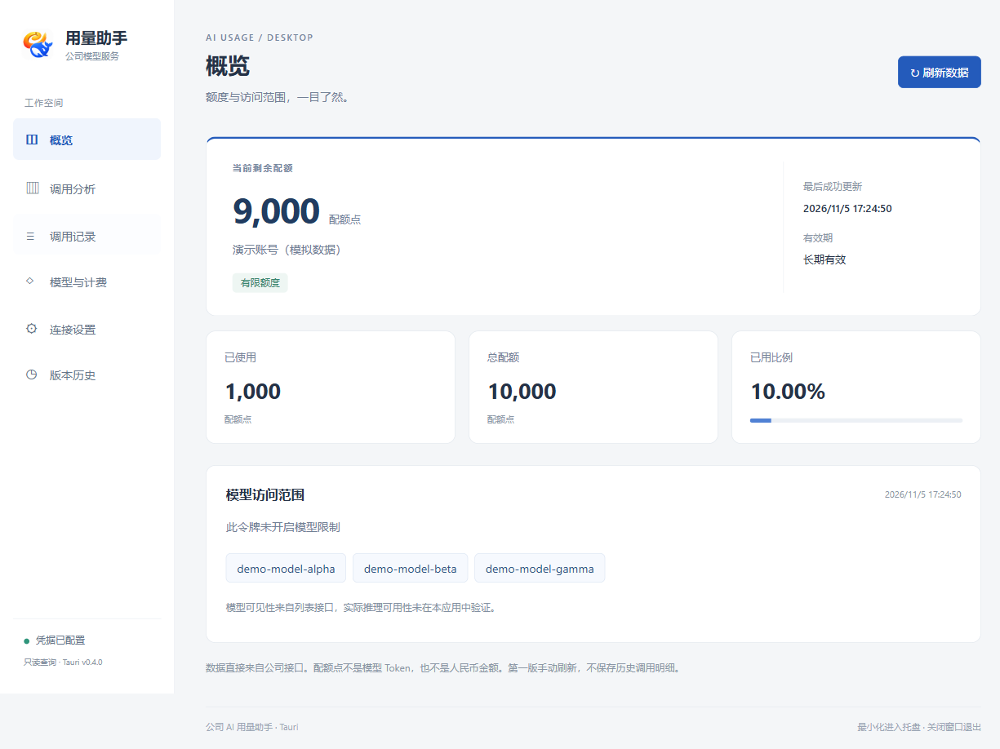
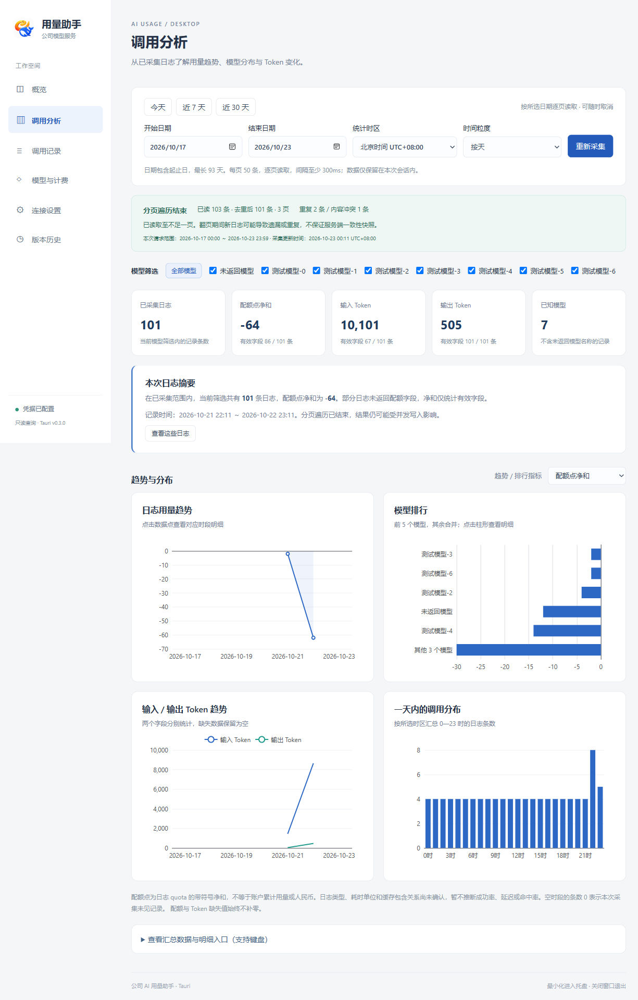
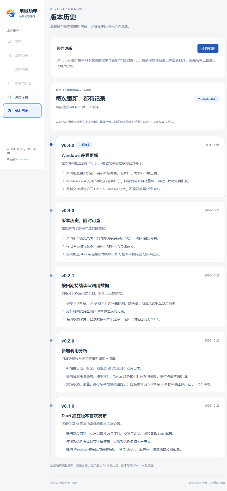

# 公司 AI 用量助手 · Tauri

一个面向公司模型服务用户的中文桌面工具：查看剩余额度、查询调用记录、分析 Token 用量，并了解当前账号可见的模型与计费信息。

**当前公开版本：v0.4.0 · Windows x64 · 提供安装版和免安装版**

[下载最新版本](https://github.com/hustwxw/ai-quota-tauri-releases/releases/latest) · [查看全部发行](https://github.com/hustwxw/ai-quota-tauri-releases/releases) · [版本演变](#版本演变)

> 本仓库用于分发安装包、免安装 EXE、签名更新清单与差异补丁。源码在独立私有仓库维护。当前未发布 macOS 安装包，差异更新仅支持 Windows x64。

下方截图来自 Windows 原生软件的隔离测试环境，额度、模型和调用记录均为模拟数据，不代表真实账号用量。截图标注了对应版本；点击图片可查看原图。

## 能做什么

### 额度概览

- 查看剩余配额、已用配额、总配额、已用比例和有效期。
- 区分有限额度与无限额度，并显示最后成功更新时间。
- 某个接口读取失败时保留其他已取得的数据，提示失败原因和更新时间。

**配额点、模型 Token 和人民币金额是不同口径，不能直接等同。**

*v0.4.0 · 正常加载的额度概览。演示账号、额度与模型名称均为模拟数据，展示剩余额度、已用比例、有效期和模型访问范围。*

### 调用分析

- 按日期、时区、模型与时间粒度分析调用记录。
- 汇总调用条数、配额消耗以及接口提供的输入/输出 Token。
- 提供用量趋势、模型排行、Token 趋势和小时分布四类图表。
- 点击图表查看对应明细，帮助定位用量集中在哪一天、哪个模型或哪个时段。
- 按所选日期持续分页读取，可取消采集；部分失败时保留已取得的结果。

单次日期范围最长 93 天。自 v0.2.1 起不再设置固定的 5,000 条、60 秒或 100 页采集上限；实际耗时仍受日志数量、网络和服务端响应影响。接口没有返回的字段会提示缺失，不自动补成零。

*v0.3.0 · 调用分析原生界面，展示四类图表与模型筛选。模拟数据包含缺失字段、重复日志和负配额，页面据实显示，不代表真实账号的计费情况。*

### 调用记录

- 分页查看每次请求的模型、时间、配额和 Token 消耗。
- 在当前已加载页内筛选模型名或请求 ID，打开记录查看详情。
- 固定表头，滚动长列表时仍能对照字段。

### 模型与计费

- 查看当前凭据可见的模型范围与模型限制信息。
- 展示接口返回的对应模型计费配置。

模型可见性来自服务接口，不代表本工具已经实际发起推理、验证每个模型可用。

### 连接设置与桌面使用

- 配置公司服务地址和个人 `skey`（API Token）。
- 凭据保存在 Windows 系统凭据库，界面不回显已保存的 Token。
- 未配置凭据时提供引导，避免误以为空白页面或接口故障。
- 最小化后进入系统托盘，点击托盘图标可恢复主窗口；Windows 下关闭窗口会退出程序。

### 版本历史与差异更新

- 在软件内查看各版本的日期、更新内容与当前运行版本。
- 版本记录内置，未配置 skey 或离线时也能查看。
- Windows x64 可在“版本历史”中检查更新，查看新版说明、补丁大小和下载进度。
- 下载与当前 EXE 匹配的差异补丁，校验后合成新程序、替换并重新启动。

*v0.4.0 · “检查更新”入口与内置版本历史；未配置 skey 时也可进入此页。*

## 下载与运行

前往 [最新 Release](https://github.com/hustwxw/ai-quota-tauri-releases/releases/latest)，展开 **Assets**，根据需要选择：

- **安装版：`AI-Quota-Tauri-<版本>-Windows-x64-Setup.exe`**，适合日常使用。运行安装程序，按向导安装，再通过快捷方式打开。
- **免安装版：`AI-Quota-Tauri-<版本>-Windows-x64.exe`**，放到一个固定、允许写入的文件夹，双击运行即可。

两个包的应用功能相同。普通用户不需要安装 Node.js 或 Rust。软件依赖 Microsoft Edge WebView2；安装版在系统缺少该运行时时会尝试下载官方组件，需要网络。

**v0.4.0 下载：** [安装版](https://github.com/hustwxw/ai-quota-tauri-releases/releases/download/v0.4.0/AI-Quota-Tauri-0.4.0-Windows-x64-Setup.exe) · [免安装版](https://github.com/hustwxw/ai-quota-tauri-releases/releases/download/v0.4.0/AI-Quota-Tauri-0.4.0-Windows-x64.exe)

Release 中的 `.bsdiff`、`update.json` 用于软件更新，**不需要手动运行**。`SHA256SUMS.txt` 用于核对下载文件的 SHA-256。

### 首次连接

1. 连接公司网络或 VPN，确保可以访问公司模型服务。
2. 打开软件，进入“连接设置”，确认服务地址。
3. 填写公司分配给你的 skey，点击“保存并测试连接”。
4. 连接成功后，在“概览”“调用分析”“调用记录”“模型与计费”中查看数据。

额度和记录通过手动操作刷新，分析结果基于本次实际取得的日志；查看时请留意更新时间与异常提示。

## 如何更新

从 v0.4.0 开始，支持以下操作：

1. 进入 **“版本历史” → “检查更新”**。
2. 有匹配更新时，查看新版说明和差异补丁大小。
3. 先结束正在进行的调用分析，再点击 **“下载差异补丁并重启更新”**。
4. 软件下载补丁、校验并合成新程序，随后退出并重新打开。

更新清单使用 Ed25519 签名；程序还会验证旧 EXE、补丁和合成后新 EXE 的 SHA-256 与长度。新版未在规定时间内完成启动确认时，更新助手会尝试恢复并重新打开旧版。

- **v0.3.0 及更早版本没有更新入口，需要先手动安装一次 v0.4.0 或后续带更新功能的版本。**
- 后续版本发布时，维护者需要为相应旧版本提供匹配补丁。没有匹配补丁时会明确提示，不会自动改为下载完整安装包。
- 更新仓库公开可下载，客户端不需要填写 GitHub Token；检查软件更新也不需要公司 skey。
- 更新期间请勿强制关机或手动删除程序目录中的更新暂存文件。

## 版本演变

**基础查询 → 调用分析 → 持续分页采集 → 内置版本历史 → Windows 差异更新**

以下记录按新到旧排列，描述 Tauri 版自身的功能演进。早期版本曾在本地交付，其日期不代表对应版本已在本公开仓库发布；当前公开 Release 为 v0.4.0。

### v0.4.0 · 2026-11-05

**Windows 差异更新**

- 新增“检查更新”，展示新版说明、补丁大小与下载进度。
- 支持签名差异补丁下载、校验合成、替换与自动重启。
- 增加新版启动失败时的旧版恢复机制。
- 通过公开 GitHub Releases 分发安装包、EXE、更新清单和补丁。

[查看 v0.4.0 Release](https://github.com/hustwxw/ai-quota-tauri-releases/releases/tag/v0.4.0)

### v0.3.0 · 2026-10-23

**版本历史，随时可查**

- 新增独立“版本历史”页面，倒序展示版本号、日期与更新内容。
- 标记当前运行版本，保留早期迭代记录。
- 无需配置 skey 或连接公司网络，也能查看本机版本记录。

### v0.2.1 · 2026-10-23

**按日期持续读取调用数据**

- 移除 5,000 条、60 秒和 100 页的采集限制，按所选日期逐页读取至结束。
- 明细支持查看第 100 页之后的记录。
- 保留取消、失败提示与已读数据；日期范围最长仍为 93 天。

### v0.2.0 · 2026-10-22

**新增调用分析**

- 增加日期、时区、模型和时间粒度筛选。
- 增加用量趋势、模型排行、Token 趋势与小时分布四类图表。
- 支持点击图表查看明细、取消采集、日志去重，以及部分结果和缺失值提示。
- 此版曾设置 5,000 条 / 60 秒采集上限，已在 v0.2.1 移除。

### v0.1.0 · 2026-10-22

**Tauri 独立版本首次发布**

- 提供额度概览、调用记录分页与详情、模型与计费、服务地址和 skey 配置。
- 使用系统凭据库保存连接信息，增加系统托盘与固定表头。
- 提供 Windows 安装版和免安装版。
- 与早期 Electron 版独立维护，可并存；两者的版本号和连接凭据不共用。

## 常见问题

### Windows 提示“已保护你的电脑”，怎么办？

当前 v0.4.0 的安装包和免安装 EXE 均未做 Windows 发布者代码签名，下载后可能出现 Microsoft Defender SmartScreen 提示。确认文件来自本仓库的 Release，且与发布校验值一致后，可在系统允许的情况下选择 **“更多信息” → “仍要运行”**。公司策略可能限制该操作，此时请联系 IT。

更新清单的 Ed25519 签名用于验证软件更新，与 Windows 发布者代码签名是两套机制；它不会消除 SmartScreen 提示。无需为了运行本软件而关闭系统防护。

### 没有 skey，能用哪些功能？

可以查看内置版本历史、检查软件更新。查询公司额度、调用记录、模型与计费，需要有效的公司 skey 和可访问的公司服务。

### 软件会调用模型、额外消耗推理 Token 吗？

本工具只读取额度、模型、计费和调用日志，不发送模型推理请求。它不会通过试调用模型来验证模型是否可用。

### macOS 能下载吗？

当前尚未发布 macOS 安装包，也未完成本轮 Mac 实机验收；请勿将 Windows EXE 用作 Mac 安装包。

## 数据与反馈

公司服务连接信息保存在本机系统凭据库；软件更新从本公开仓库获取文件，不向更新仓库上传公司 skey 或调用日志。分析结果以服务接口实际返回的数据为准。

遇到问题，可通过 [Issues](https://github.com/hustwxw/ai-quota-tauri-releases/issues) 反馈软件版本、Windows 版本、操作步骤和错误提示。**请勿在公开 Issue、截图或附件中提交 skey、账号凭据、公司内网地址或原始调用日志。**
